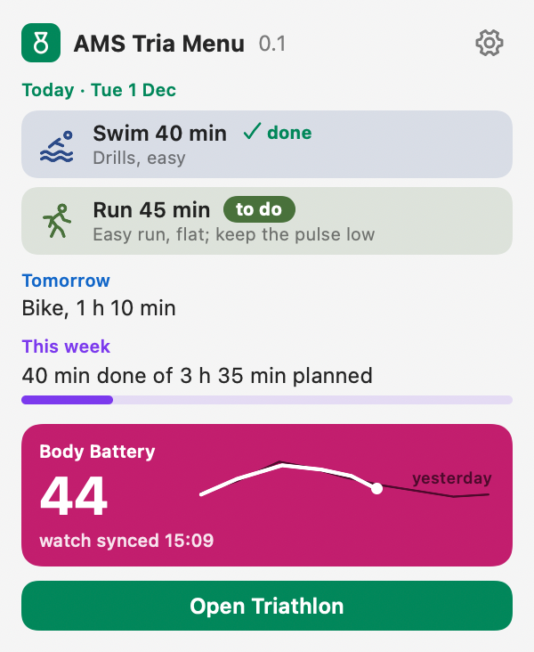
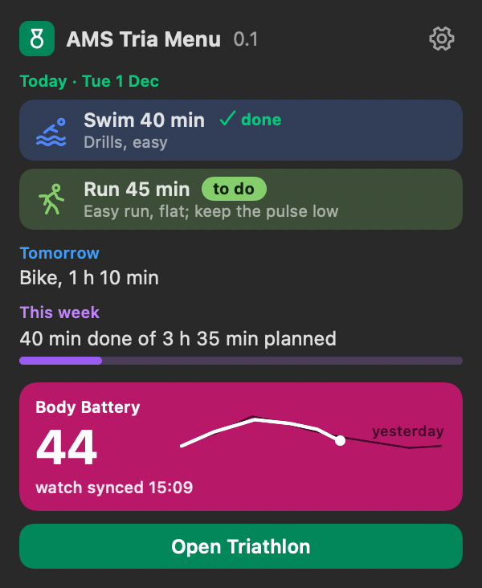

# AMS Tria Menu

AMS Tria Menu is a small Mac menu bar app that shows today's training session and your Garmin Body Battery at a glance. A small mark in the menu bar tells you what is still to do (or that it is done, or a rest day), with your Body Battery beside it. A click opens a panel with today, tomorrow, the week and a small Body Battery curve. It only reads and never changes your plan.

 

The menu bar item's faces (a session to do in its sport's colour, the green tick, the moon of a rest day, grey):


All values in the pictures are invented.

It is a personal app for an Apple Silicon Mac, macOS 15 or later. Use it at your own risk.

## What it needs

- AMS Triathlon Training 2.8 or newer on the same Mac. It writes a small note about today that this app reads.
- The AMS Garmin Bridge Board on the same Mac, for Body Battery.

## Build and install

```
xcodegen generate
xcodebuild -scheme "AMS Tria Menu" -configuration Release -derivedDataPath build build
Tools/install.sh
```

## Rule tests

```
swift test --package-path Core
```

The full specification is in `Docs/SPEC.md`.

This repository contains no personal data.
